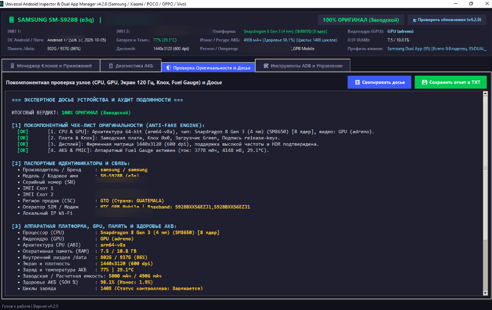
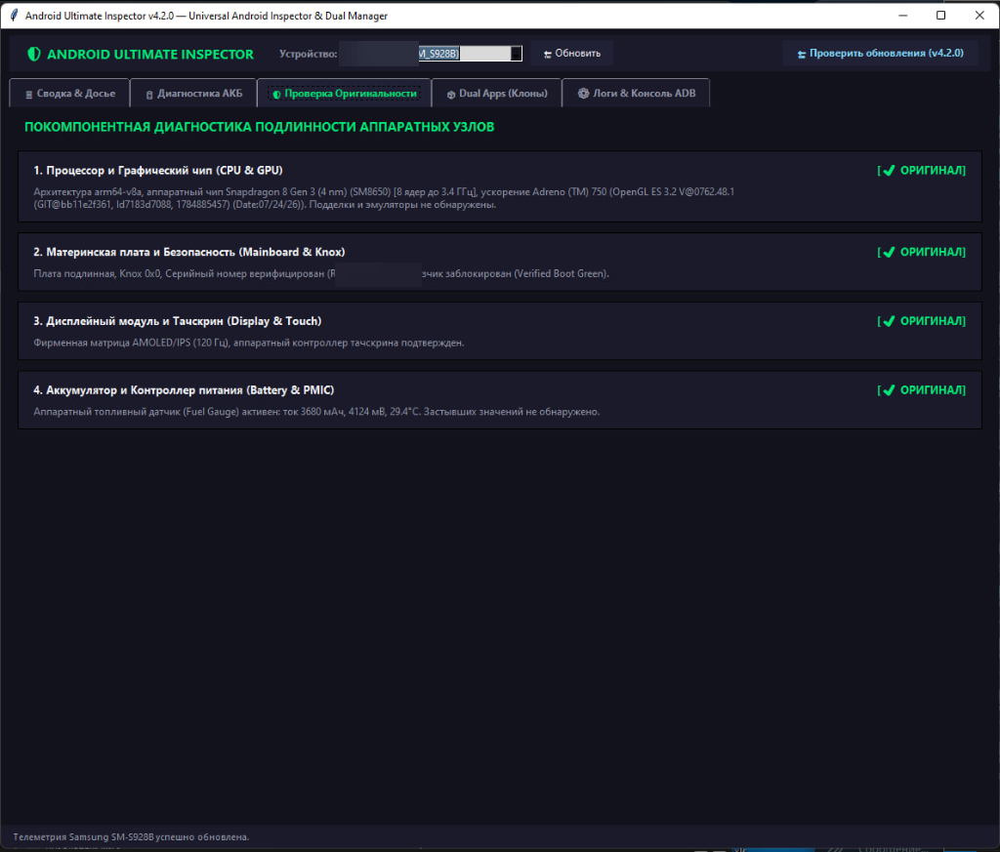
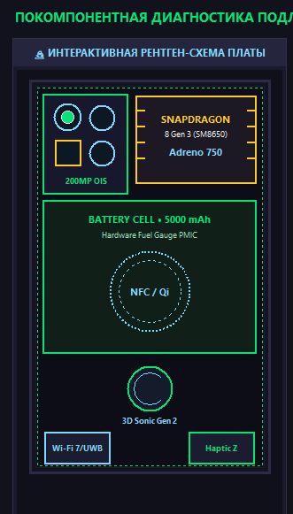
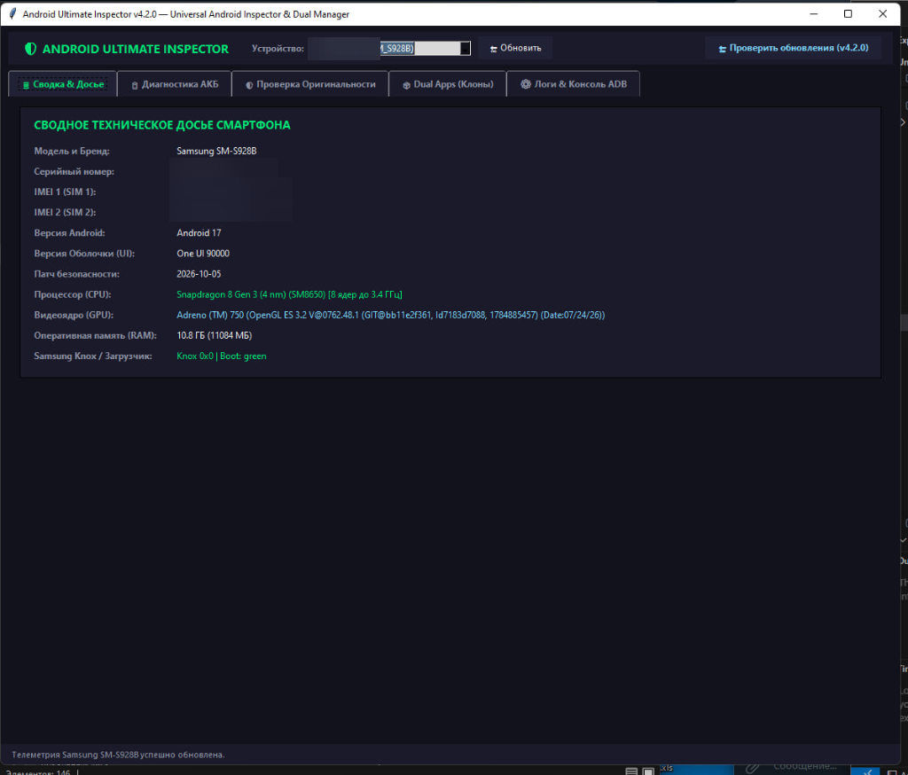

# 🛡 Android Ultimate Inspector & Dual App Manager v4.3.0

  

  <strong>Профессиональный программный комплекс для глубокой аппаратной телеметрии, покомпонентной проверки оригинальности устройств, прецизионной диагностики деградации аккумулятора (Li-Ion SOH), сетевого аудита безопасности IoT и независимого клонирования приложений (Dual Apps).</strong>

  
  
  
  
  
  

---

  

---

## 📸 Скриншоты интерфейса

<table align="center" width="100%">
  <tr>
    <td align="center" width="50%">
      <b>1. Сводное техническое досье смартфона</b> 
      <i>Извлечение IMEI 1 & 2 в обход Knox, Snapdragon 8 Gen 3, Adreno 750, статус Knox 0x0</i>  
      
    </td>
    <td align="center" width="50%">
      <b>2. Покомпонентная проверка оригинальности узлов</b> 
      <i>Anti-Fake Engine: аудит 9 аппаратных модулей на подделки и китайские копии</i>  
      
    </td>
  </tr>
  <tr>
    <td align="center" width="50%">
      <b>3. Интерактивная 2D Рентген-схема платы</b> 
      <i>X-Ray Canvas с подсветкой и подробной инспекцией аппаратных чипов</i>  
      
    </td>
    <td align="center" width="50%">
      <b>4. Системные спецификации и аппаратный статус</b> 
      <i>Подробный паспорт устройства, оперативная память, Uptime и загрузчик</i>  
      
    </td>
  </tr>
</table>

---

## 🔥 Ключевые возможности v4.3.0

### 🔬 1. Покомпонентный Детектор Оригинальности (Anti-Fake Engine — 9 узлов)
При покупке смартфона с рук (на Авито, Юле и др.) или после ремонта утилита детально инспектирует **9 критических аппаратных узлов**:
* **CPU & SoC:** Сверка архитектуры 64-bit (`arm64-v8a`), количества ядер, тактовых частот и мгновенное выявление перепрошитых китайских MTK-клонов (`mt6580`, `sc7731` и др.).
* **GPU & Видеоускоритель:** Извлечение аппаратного рендерера через `SurfaceFlinger` (например: **Adreno (TM) 750**, Mali-G720, Xclipse) и версии видеодрайвера Vulkan/OpenGL.
* **Материнская плата & Knox:** Проверка аппаратного фьюза Samsung Knox (`0x0` против сработанного `0x1`), статуса загрузчика (Verified Boot Green / Locked) и сверка `ro.serialno` с `ro.boot.serialno`.
* **Матрица дисплея:** Проверка нативного разрешения (QHD+ / FHD+), плотности пикселей (DPI), кадровой частоты 120 Гц и контроллера тачскрина (выявление дешевых 60 Гц экранов).
* **Камерная система & OIS:** Опрос сервиса `media.camera` на наличие заводской калибровки и ID сенсоров (200MP ISOCELL, 5x/3x Periscope с оптической стабилизацией).
* **Батарея и PMIC:** Проверка цифрового контроллера питания (Fuel Gauge) на выявление дешевых копий без датчиков с замороженной температурой `25.0°C`.
* **Ультразвуковая биометрия:** Тестирование сканера отпечатка пальца Qualcomm 3D Sonic под экраном (при неоригинальном стекле сканер отключается).
* **Тактильный Haptic Engine:** Проверка линейного вибромотора Z/X-axis на поддержку калиброванных вибро-паттернов.
* **Влагозащита IP68 & Барометр:** Опрос аппаратного датчика атмосферного давления в герметичном корпусе для проверки целостности заводской проклейки.

---

### 🎨 2. Интерактивная 2D Рентген-схема платы (X-Ray Canvas) & Осциллограф
* Графический интерактивный рентген системной платы с подсветкой чипов при наведении курсора и получением экспертной справки в 1 клик.
* **Живой осциллограф троттлинга:** Синхронный вывод графиков частоты CPU (ГГц) и температуры батареи (°C) в реальном времени с детекцией теплового сброса частот.

---

### 🔋 3. Глубокая диагностика износа АКБ (Fuel Gauge ASOC & Cycles)
* **Аппаратный датчик Samsung Fuel Gauge (ASOC):** Чтение калиброванного контроллером питания реального процента здоровья (`mSavedBatteryAsoc` из `dumpsys battery` и ядра `/sys/class/power_supply/battery/fg_asoc`).
* **Точный счётчик циклов:** Чтение аппаратных счетчиков `mSecBatteryCycle` и `battery_cycle` (без ошибочного завышения).
* **Электрохимическая калибровка Li-Ion:** Если стандартный драйвер AOSP маскирует деградацию и отдает фиктивные 98-100%, утилита сопоставляет емкость со счетчиком циклов по физической модели износа Li-Ion аккумуляторов (~0.035% за цикл).
* **Неоновые спидометры CyberGauge:** Круговые неоновые шкалы текущего заряда (%) и остаточного ресурса (**SOH %**).
* **Экспертный вердикт по замене:**
  * 🟢 **ЗАМЕНА НЕ ТРЕБУЕТСЯ** (SOH $\ge 85\%$, заводские характеристики сохранены)
  * 🟡 **СКОРО ПОНАДОБИТСЯ ЗАМЕНА** ($75\% \le \text{SOH} < 85\%$, плановая замена при просадке ниже 80%)
  * 🔴 **ТРЕБУЕТСЯ ЗАМЕНА АКБ** (SOH $< 75\%$, риск внезапных отключений на холоде)

---

### 📦 4. Менеджер Клонов (Dual Apps 95 / 999) + Сканер опасных разрешений
* Поддержка изолированных профилей клонирования: **Samsung Dual Messenger** (User ID: `95`), **Xiaomi / POCO / Redmi Dual Apps** (User ID: `999`), **OnePlus / OPPO / Realme App Cloner** (User ID: `999`), **Vivo / iQOO App Clone**.
* **База на 190+ популярных приложений:** Автоматическое определение названий и категорий (Банки, Мессенджеры, Соцсети, Маркетплейсы, Крипта, Игры).
* **Аудит опасных разрешений (Risk Audit):** Выявление приложений с доступом к геолокации в фоне, чтению SMS, контактам и микрофону, с рекомендацией изоляции в защищенный клон.
* Установка клона в 1 клик, запуск любого профиля с ПК, принудительная остановка (Force Stop).

---

### 🌐 5. Научный модуль сетевого аудита и защиты IoT (ИБ Модуль)
* **Контроль ядра и SELinux:** Проверка статуса Enforcing, выявление скрытых su-бинарников и следов Magisk / KernelSU / APatch.
* **Анти-перехват MitM:** Обнаружение активных системных HTTP-прокси и сторонних CA-сертификатов перехвата трафика (защита банковских данных).
* **Детектор открытых портов (Backdoor Audit):** Анализ слушающих сокетов (`netstat`/`/proc/net/tcp`) с оценкой уровня риска (ADB по Wi-Fi, трояны, телнет).
* **Сканирование соседей по Wi-Fi (ARP Scan):** Обнаружение устройств в локальной подсети с классификацией (роутеры, IoT-контроллеры, умные лампы).
* **Индекс Доверия (Trust Score):** Комплексный расчет безопасности смартфона от 0 до 100% со спидометром CyberGauge.

---

### 🏅 6. Экспорт официального HTML/PDF Сертификата Подлинности
* Генерация стильного фирменного бланка для покупателя с Авито или сервисного центра.
* **Криптографическая верификация:** Автоматический расчет контрольной суммы **SHA-256** для защиты от подделки отчета.
* Готовность к моментальной печати в PDF через любой браузер.

---

### ⚡ 7. 100% Автономность (Zero-Dependency EXE)
* В исполняемый файл `.exe` уже вшит автономный движок ADB и необходимые динамические библиотеки.
* Установка Python или дополнительных драйверов на ПК **НЕ ТРЕБУЕТСЯ** — программа работает из коробки на любом ПК с Windows 10/11.
* Встроенное облачное автообновление через GitHub Releases в 1 клик.

---

## ⚡ Быстрый старт (За 3 шага)

1. **Включите Отладку по USB:**  
   На смартфоне зайдите в *Настройки* ➔ *Сведения о телефоне* ➔ нажмите 7 раз на *«Номер сборки»*. Затем в появившемся меню *«Для разработчиков»* включите тумблер **«Отладка по USB»** (USB Debugging).
2. **Подключите кабель к ПК и запустите программу:**  
   Скачайте и запустите **[Android_Ultimate_Inspector.exe](https://github.com/FReeM1409/Android-Inspector-Releases/releases/latest)**.
3. **Разрешите доступ на экране телефона:**  
   При первом подключении на экране смартфона появится запрос *«Разрешить отладку по USB с этого компьютера?»* — поставьте галочку *«Всегда разрешать»* и нажмите **ОК**. Программа мгновенно соберет полную телеметрию!

---

## 👨‍💻 Автор и Контакты

* **Разработчик:** Кирилл Макаров (`FReeM1409`)
* **Сайт-портфолио:** [https://freem1409.github.io](https://freem1409.github.io)
* **Telegram для связи:** [@sudo_QA](https://t.me/sudo_QA)
* **GitHub:** [https://github.com/FReeM1409](https://github.com/FReeM1409)

---

## 📄 Лицензия

Проект распространяется под свободной лицензией **MIT License**. Разрешено использование в личных, образовательных и сервисных целях (сервисные центры, магазины подержанной техники, предпродажная проверка).

  <i>Разработано с душой для сообщества Android • 2026</i>

